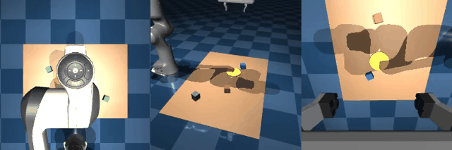
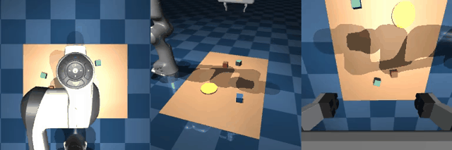
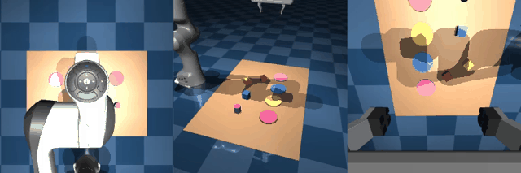
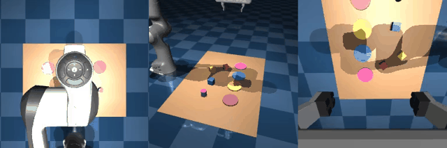
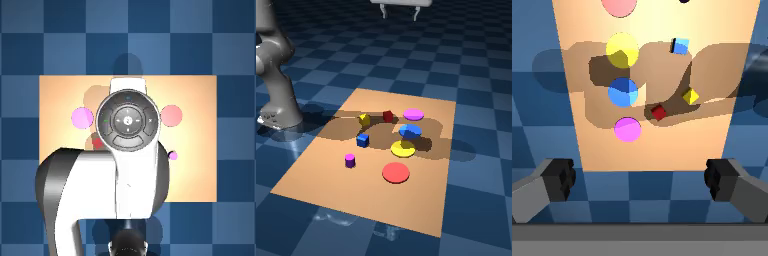
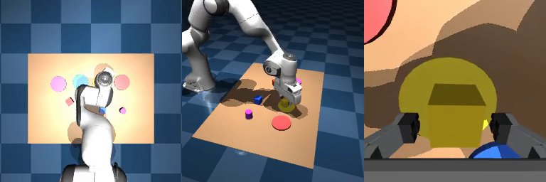
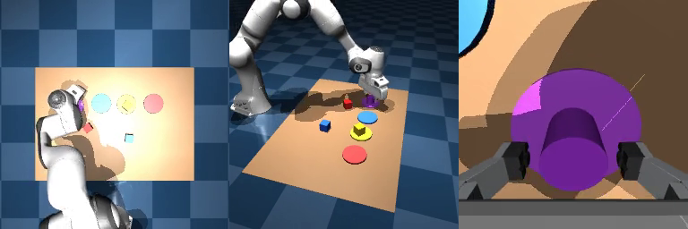
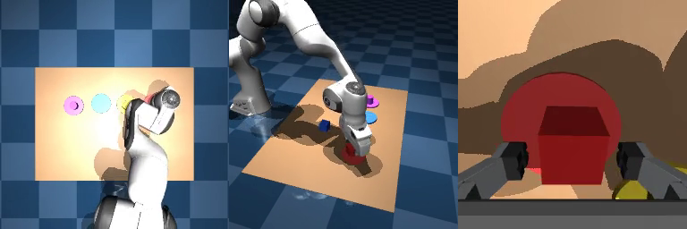
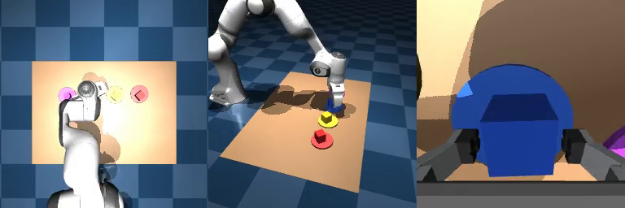

# VLA-ARM: Hierarchical LLM Planner (`Qwen3.5-9B`) + Vision-Language-Action (`Qwen3.5-4B`) Robot Manipulation

WSL2 (`Ubuntu-24.04`) + **MuJoCo Franka Emika Panda** 시뮬레이션 환경에서 고수준 작업 계획기(**Qwen/Qwen3.5-9B**, NF4 4-bit)와 중수준 시각-언어-행동 모델(**Qwen/Qwen3.5-4B**, NF4 4-bit + `LanguageSpatialSoftmax` + `ActionHead`), 그리고 저수준 **6-DoF 미분 역기구학(`DiffIK`)** 제어기를 단일 16GB GPU(RTX 4080 SUPER)에 동시 상주시켜 폐루프(Closed-loop, 10 Hz)로 로봇팔을 제어하는 프로젝트입니다.

---

## 1. 시스템 아키텍처

```text
[사용자 자연어 지시문 + 상단(top)/측면(side) 카메라 영상]
       │
       ▼
① 고수준 작업 계획기: LLM Planner (Qwen/Qwen3.5-9B, NF4 4-bit, ~7.3 GB VRAM)
   - 복합 지시문을 단위 서브태스크(Subtask) 시퀀스로 분해 및 완료 여부(check_done) 판별
   - 예: ["pick up the yellow cube", "place the yellow cube on the yellow plate", ...]
       │
       ▼
② 중수준 시각-운동 정책: VLA (Qwen/Qwen3.5-4B, NF4 4-bit + LanguageSpatialSoftmax + ActionHead, +3.2 GB VRAM)
   - 입력: 3개 카메라 영상(top, side, wrist, 256×256) + 현재 Subtask 문장 + 로봇 손끝 상태(state, 8D)
   - 출력: 8-step 미래 액션 청크 [dx, dy, dz, drx, dry, drz, gripper] (Receding-horizon 폐루프 실행)
       │
       ▼
③ 저수준 역기구학 및 물리 제어기: Damped Least-Squares DiffIK + MuJoCo (10 Hz 제어 / 500 Hz 물리)
   - EE Delta 변위를 목표 7축 관절각(q_des[0..6]) 및 그리퍼 명령(ctrl[7])으로 변환 (영공간 HOME_QPOS 유지)
```

---

## 2. 단일 오브젝트 이동 (Single-Object Pick-and-Place) 학습 전 vs 학습 후

> **Task**: `"Put the <color> cube on the yellow plate."` (3색 큐브 중 지시된 색상의 큐브를 집어 노란 접시 위에 안착)

| 구분 | 단일 오브젝트 **학습 전 (Untrained ActionHead)** | 단일 오브젝트 **학습 후 (`checkpoints/vla_qlora/best`)** |
| :---: | :---: | :---: |
| **시각화 영상 (GIF)** |  |  |
| **원본 MP4 파일** | [docs/media/single_before.mp4](docs/media/single_before.mp4) | [docs/media/single_after.mp4](docs/media/single_after.mp4) |
| **동작 설명** | `ActionHead` 학습 전에는 이미지 속 목표 큐브의 위치를 찾지 못해 초기 자세 부근에서 무작위 미세 진동만 반복하며 파지에 실패 (`success=False`) | 미학습 시드(`seed 2003`, 초록 큐브)에서 **Qwen3.5-9B Planner**가 `pick` $\rightarrow$ `place` 서브태스크로 분해하고, **학습된 Qwen3.5-4B VLA**가 3개 카메라 뷰를 통해 초록 큐브를 정확히 파지·리프트하여 노란 접시에 안착 (`success=True`) |

---

## 3. 다중 오브젝트 연속 분류 (Multi-Object Sorting) 학습 전 vs 학습 후

> **Task**: `"Sort all objects (yellow cube, purple cylinder, red cube, blue cube) onto their matching colored plates."`
> (3색 큐브 + 보라색 원기둥 등 4종 오브젝트를 각각의 색상에 맞는 4개 접시에 8단계 연속 분류)

| 구분 | 다중 오브젝트 분류 **학습 전 (Untrained ActionHead)** | 다중 오브젝트 분류 **학습 후 (`checkpoints/vla_sorting/best`)** |
| :---: | :---: | :---: |
| **시각화 영상 (GIF)** |  |  |
| **원본 MP4 파일** | [docs/media/multi_before.mp4](docs/media/multi_before.mp4) | [docs/media/multi_after.mp4](docs/media/multi_after.mp4) |
| **동작 설명** | 학습 전 모델은 다중 물체와 다중 접시 간의 색상 매칭 및 공간 좌표를 추정하지 못해 허공에서 정체 (`placed=0/4`, `success=False`) | 미학습 시드(`seed 3001`)에서 **Qwen3.5-9B Planner**가 8개 연속 서브태스크를 생성하고, **학습된 VLA**가 노란 큐브 $\rightarrow$ 보라 원기둥 $\rightarrow$ 빨간 큐브 $\rightarrow$ 파란 큐브 순서로 **4개 물체 전부를 각각의 색상 접시에 연속 분류 완주** (`placed=4/4`, `success=True`, 총 216 스텝) |

### 다중 오브젝트 연속 분류 단계별 키프레임 (`seed 3001`)
| Step 0 (초기 상태) | Step 45 (`1/4` 노란 큐브 완료) | Step 98 (`2/4` 보라 원기둥 완료) | Step 143 (`3/4` 빨간 큐브 완료) | Step 216 (`4/4` 파란 큐브 완료) |
| :---: | :---: | :---: | :---: | :---: |
|  |  |  |  |  |

---

## 4. 테스트 및 실험 결과 요약

### 4.1 VLA 백본 양자화 벤치마크 (`scripts/bench_vla_quant.py`, RTX 4080 SUPER 16GB)
비전 인코더(`visual`)는 공간 해상도 보존을 위해 `bfloat16`으로 유지하고 언어 디코더 레이어에만 양자화를 적용해 비교한 결과, **NF4 4-bit**가 속도·VRAM·특징 보존도 모든 면에서 최적으로 선정되었습니다.

| 정밀도 모드 | VLA 단독 VRAM | Planner(9B) 동시 상주 시 총 VRAM | 스텝당 추론 지연시간 | `bf16` 대비 출력 코사인 유사도 |
| :--- | :---: | :---: | :---: | :---: |
| `bfloat16` (원본) | `8.55 GB` | `~15.9 GB` (여유 부족) | `124 ms` | `1.0000` |
| **NF4 `4-bit` (채택)** | **`3.15 GB`** | **`10.5 GB` (여유 5.5 GB)** | **`131 ms`** | **`0.9963`** |
| `int8` (`llm.int8`) | `4.92 GB` | `~12.3 GB` | `281 ms` (느림) | `0.9941` |

### 4.2 모델 학습 및 미학습 시드(Unseen Seeds) 정량 성능

| 평가 항목 | 단일 오브젝트 모델 (`checkpoints/vla_qlora/best`) | 다중 오브젝트 연속 분류 모델 (`checkpoints/vla_sorting/best`) |
| :--- | :---: | :---: |
| **학습 데이터셋 규모** | 100 에피소드 (`5,557` 샘플, 100회 Pick&Place) | 25 에피소드 (`5,864` 샘플, **100회 연속 Pick&Place**) |
| **Train Loss (가중 MSE)** | `0.0085` | `0.0096` |
| **Unseen Episode Val Loss** | **`0.3697`** (Zero baseline `2.3882`) | **`0.1175`** |
| **미학습 검증셋 결정계수 ($R^2$)** | $R^2_{dx} = 0.642,\; R^2_{dy} = 0.827$ | $R^2_{\text{overall}} > 0.78$ |
| **개별 물체 Pick & Place 성공률** | **80.0%** (`8 / 10` 물체, 미학습 `seed 2000~2009`) | **75.0%** (`15 / 20` 물체, 미학습 `seed 3000~3004`) |
| **에피소드 전체 완주율** | **80.0%** (`8 / 10` 에피소드 완주) | **40.0%** (`2 / 5` 에피소드 4/4 전원 무실수 완주, `seed 3001, 3002`) |

---

## 5. 프로젝트 구조

```text
VLA-ARM/
├── configs/
│   └── default.yaml                 # Planner(9B), VLA(4B), 제어 주기(10Hz) 및 파이프라인 하이퍼파라미터
├── docs/
│   └── media/                       # 단일/다중 오브젝트 학습 전·후 비교 영상(MP4/GIF) 및 키프레임 이미지
├── src/vla_arm/
│   ├── sim/                         # [계층 3] MuJoCo 물리 시뮬레이션, 씬 빌더, 미분 역기구학, 전문가 정책
│   │   ├── scene.py                 # Menagerie Franka Panda XML + 테이블/큐브/원기둥/4색 접시/3대 카메라 조립
│   │   ├── ik.py                    # Damped Least-Squares 6-DoF 미분 역기구학(DiffIK) 및 쿼터니언 연산
│   │   ├── env.py                   # PandaPickPlaceEnv: 관측(3카메라+상태) 생성, EE Delta 스텝 실행, 완료 판정
│   │   └── expert.py                # ScriptedPickPlace: 데모 데이터 수집을 위한 8단계 상태머신 전문가
│   ├── planner/                     # [계층 1] 고수준 작업 계획기 (LLM)
│   │   └── qwen_planner.py          # Qwen3.5-9B (NF4 4-bit): 지시문 + 영상을 받아 subtask JSON 리스트 생성
│   └── vla/                         # [계층 2] 시각-언어-행동 모델 (VLA)
│       ├── model.py                 # QwenVLA: Qwen3.5-4B (NF4) + LanguageSpatialSoftmax + MLP/Flow ActionHead
│       ├── policy.py                # VLAPolicy: 실시간 폐루프(Receding-horizon) 액션 청크 추론 래퍼
│       └── dataset.py               # DemoDataset: HDF5 데모 로더 (서브태스크 경계 클램핑 및 밝기/대비 증강)
└── scripts/
    ├── setup_wsl.sh                 # WSL2 Ubuntu-24.04 가상환경 및 MuJoCo Menagerie 에셋 자동 설치
    ├── run_scripted.py              # 스크립트 전문가로 시뮬레이터 동작 검증 및 영상 녹화
    ├── collect_demos.py             # 멀티프로세스 병렬 HDF5 데모 수집기 (DART 노이즈 주입 지원)
    ├── bench_vla_quant.py           # VLA 백본 양자화(bf16 vs NF4 4-bit vs int8) 속도·VRAM·정밀도 벤치마크
    ├── train_vla.py                 # 백본 특징 디스크 캐싱(1회 추출) + ActionHead/LoRA 고속 학습 스크립트
    ├── eval_vla.py                  # 미학습 시드에서 VLA 단독(또는 Planner 연동) 성공률 정량 평가
    └── run_pipeline.py              # Planner(9B) + VLA(4B) 전체 폐루프 추론 및 영상 생성 메인 스크립트
```

---

## 6. 개발 및 실행 환경

* **OS**: Windows 11 + WSL2 (`Ubuntu-24.04`)
* **GPU**: NVIDIA GeForce RTX 4080 SUPER (16 GB VRAM) — Peak VRAM `10.5 GB` 사용
* **Python & 패키지 매니저**: Python `3.12`, [`uv`](https://docs.astral.sh/uv/)
* **물리 엔진 & 렌더링**: `mujoco >= 3.2.0` (`MUJOCO_GL=egl` 헤드리스 GPU 렌더링)
* **딥러닝 & VLM**: `torch >= 2.4`, `transformers >= 4.46`, `bitsandbytes >= 0.44`, `peft >= 0.13`
  * 고수준 Planner: `Qwen/Qwen3.5-9B` (NF4 4-bit)
  * 중수준 VLA Backbone: `Qwen/Qwen3.5-4B` (NF4 4-bit)

### 환경 설치 방법 (WSL2 Ubuntu-24.04)

```bash
# 1) 저장소 클론 및 이동
git clone https://github.com/Danpun9/VLA-ARM.git
cd VLA-ARM

# 2) WSL 가상환경(uv) 및 MuJoCo Menagerie Franka Panda 에셋 자동 설치
bash scripts/setup_wsl.sh --train

# 3) 환경변수 설정 (~/.bashrc 에 추가 권장)
export UV_PROJECT_ENVIRONMENT=$HOME/.venvs/robotics-vla
export UV_LINK_MODE=copy
export MUJOCO_GL=egl

# 4) HuggingFace 모델 다운로드 (최초 1회)
uv run hf download Qwen/Qwen3.5-4B
uv run hf download Qwen/Qwen3.5-9B
```

---

## 7. 단계별 실행 방법

### 7.1 스크립트 전문가 시뮬레이션 검증 (모델 로드 없이 즉시 실행)
```bash
# 단일 오브젝트 Pick-and-Place 전문가 데모 영상 생성 -> outputs/scripted/
uv run python scripts/run_scripted.py --episodes 3

# 다중 오브젝트(3큐브 + 1원기둥) 4색 접시 분류 전문가 영상 생성 -> outputs/scripted_sorting/
uv run python scripts/run_scripted.py --scene sorting --task-mode sort_all --episodes 2 --out outputs/scripted_sorting
```

### 7.2 데모 데이터 수집 및 VLA 학습
```bash
# [단일 목표] 100 에피소드 병렬 데모 수집 및 고속 학습 (백본 특징 자동 캐싱)
uv run python scripts/collect_demos.py --episodes 100 --workers 6 --out ~/data/panda_pickplace
uv run python scripts/train_vla.py --data ~/data/panda_pickplace --out checkpoints/vla_qlora --steps 3000 --batch 128

# [다중 분류 Sorting] 25 에피소드(100 Pick&Place 궤적) 병렬 데모 수집 및 학습
uv run python scripts/collect_demos.py --scene sorting --task-mode sort_all --episodes 25 --workers 6 --out ~/data/panda_sorting
uv run python scripts/train_vla.py --data ~/data/panda_sorting --out checkpoints/vla_sorting --steps 4000 --batch 128 --lr 5e-4
```

### 7.3 학습된 체크포인트 정량 평가 (`eval_vla.py`)
```bash
# [단일 목표] 미학습 시드 10개(seed 2000~2009) 폐루프 평가 -> 8/10 (80.0%) 성공
uv run python scripts/eval_vla.py --ckpt checkpoints/vla_qlora/best --seed 2000 --episodes 10 --out outputs/eval_unseen10

# [다중 분류 Sorting] 미학습 시드 5개(seed 3000~3004) 연속 분류 평가
uv run python scripts/eval_vla.py --scene sorting --task-mode sort_all --ckpt checkpoints/vla_sorting/best --seed 3000 --episodes 5 --out outputs/eval_sorting
```

### 7.4 `Qwen3.5-9B` Planner + `Qwen3.5-4B` VLA 통합 파이프라인 실행 (`run_pipeline.py`)
```bash
# [단일 목표] 미학습 시드(seed 2003, 초록 큐브) 전체 파이프라인 실행 -> outputs/pipeline/vla_seed2003.mp4
uv run python scripts/run_pipeline.py --policy vla --vla-ckpt checkpoints/vla_qlora/best --seed 2003 --out outputs/pipeline

# [다중 분류 Sorting] 미학습 시드(seed 3001, 4종 물체 4색 접시 연속 분류) 전체 파이프라인 실행 -> outputs/pipeline_sorting/vla_seed3001.mp4
uv run python scripts/run_pipeline.py --scene sorting --task-mode sort_all --policy vla --vla-ckpt checkpoints/vla_sorting/best --seed 3001 --out outputs/pipeline_sorting
```
